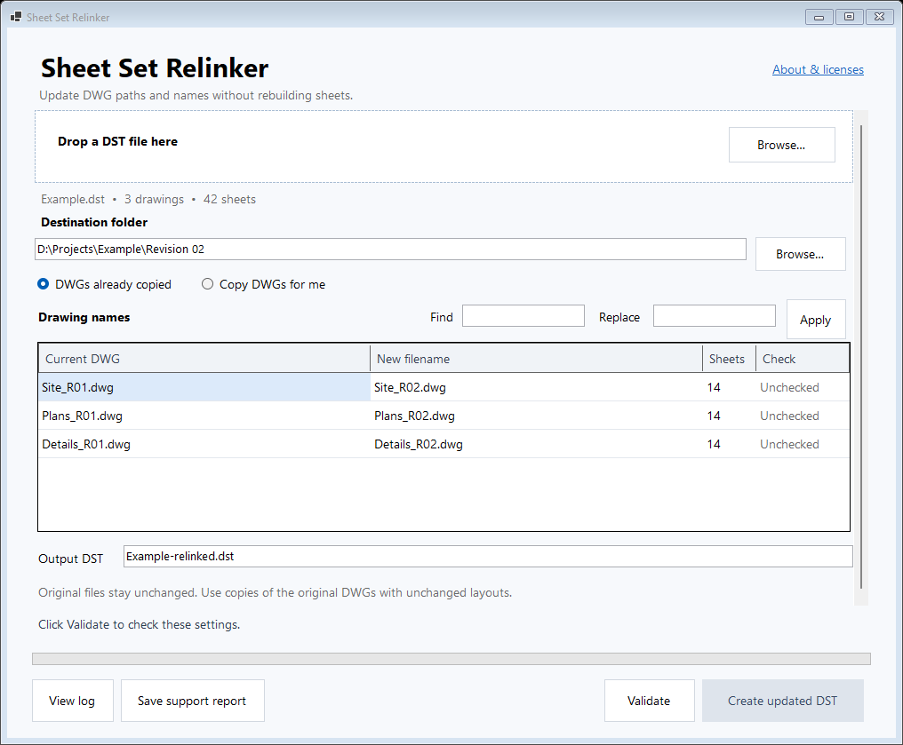

# Sheet Set Relinker

**Bulk update AutoCAD Sheet Set (`.dst`) drawing paths and DWG filenames after copying a project.** Keep the existing sheets, subsets, sheet properties, layout references, and IDs instead of rebuilding the sheet set or reconnecting each sheet by hand.

Sheet Set Relinker is a small, offline Windows desktop utility. Drag in a DST, choose the new drawing folder, review the filename mapping, validate, and create a separate updated DST. It can also copy the referenced DWGs for you.

[**Download the Windows x64 ZIP**](https://github.com/tiagovasc/autocad-dst-relinker/raw/refs/heads/main/download/SheetSetRelinker-windows-x64.zip), extract it, and double-click `SheetSetRelinker.exe`. Only the EXE is needed to run the app.

The executable includes its .NET runtime. Users do not need an installer, a separate runtime, Python, Visual Studio, an administrator account, or an AutoCAD installation to run it. The utility makes no internet requests; access to a network share is needed only if your selected files are stored there.



## The problem it solves

Copying a project to a new revision folder does not necessarily update every drawing reference stored in its sheet set. Renaming the DWGs can leave the copied DST pointing to old files or files that no longer exist. The sheets and layouts are still correct; their file references need changing.

For example, move the references to `D:\Projects\Example\Revision 02` and apply these names:

| Current DWG | New filename |
| --- | --- |
| `Site_R01.dwg` | `Site_R02.dwg` |
| `Plans_R01.dwg` | `Plans_R02.dwg` |
| `Details_R01.dwg` | `Details_R02.dwg` |

Each unique drawing appears once in the mapping, even when many sheets use it. All matching sheet layout references are updated together.

## Get started

[**Download the Windows x64 ZIP**](https://github.com/tiagovasc/autocad-dst-relinker/raw/refs/heads/main/download/SheetSetRelinker-windows-x64.zip). Right-click the downloaded ZIP, choose **Extract All**, then double-click `SheetSetRelinker.exe` in the extracted folder. The ZIP is included directly in this repository's `download` folder and is also provided as a release asset.

Alternatively, [download the EXE directly](https://github.com/tiagovasc/autocad-dst-relinker/releases/latest/download/SheetSetRelinker.exe). Only the EXE is required; the ZIP's instructions, checksum, and license files are for reference. The build instructions below are for developers.

1. Keep your original project. Close the sheet set in AutoCAD before preparing a new revision.
2. Open `SheetSetRelinker.exe` and drop the original `.dst` into the window, or use **Browse**.
3. Choose an existing **Destination folder** for the new DWGs and output DST.
4. Select the mode:
   - **DWGs already copied:** the new drawings must already exist in the destination folder, with the new filenames.
   - **Copy DWGs for me:** the original drawings must be accessible. Use **Locate…** on a row if its source is missing or ambiguous. The utility copies each unique drawing to the destination with its new filename; existing destination files are not overwritten.
5. Review **Drawing names**. Edit each new filename, or use **Find / Replace with / Apply** for a repeated revision suffix. Keep the `.dwg` extension.
6. Choose a new output DST filename and click **Validate**. The DST will be saved in the destination folder. Resolve all errors before continuing.
7. Click **Create updated DST**. Wait for completion, then open the new DST in AutoCAD's Sheet Set Manager.
8. Open sheets from every referenced DWG and check that they open from the new folder, show the intended layout, and display the expected title-block fields. Check your normal publish workflow before using the revision for delivery.

**Use actual copies of the original drawings that retain their layout names and internal layout handles.** A newly drawn DWG with the same filename or a similarly named layout is not an equivalent replacement. The utility checks references and files; it does not open or validate the contents of DWGs.

## Scope

The utility updates only these existing properties inside sheet `AcSmAcDbLayoutReference` objects:

- `FileName`
- `Relative_FileName`
- `Unc_FileName`

Sheet and subset structure, order, names, numbers, custom properties, object IDs, layout names, and layout handles are retained. The original DST is never edited. Output is written to a new file, with overwrite refused. Unsupported input is rejected rather than guessed at.

This is a **DST reference relinker**, not a complete CAD project migration tool. It does not modify:

- DWG contents, Xrefs, image references, data links, or layout internals.
- Other DST references such as publishing resources, templates, page-setup sources, or support paths.
- CAD file versions or independently recreated layouts.

If your project uses those resources, check and update them separately in AutoCAD.

## Validation, progress, and logs

The window shows validation results, operation progress, and a completion or error message. Validation checks the supported DST structure, filename mappings, required source or destination files, and output conflicts. The new DST is checked again after writing.

Detailed diagnostics stay in `%LOCALAPPDATA%\SheetSetRelinker\Logs` and are available through **View log**. They are intended to help a person or LLM investigate a failed operation. **Detailed logs contain file and folder paths and may reveal confidential project information.** Use **Save support report** for a sanitized report, and review it before sharing; automatic redaction is not a confidentiality guarantee.

See [Troubleshooting](docs/TROUBLESHOOTING.md) for common failures and a useful support-report template. Do not upload private DSTs, DWGs, or unreviewed logs to a public GitHub issue.

## Compatibility and verification

This is an independent utility using a reverse-engineered DST byte codec. It does **not** use the Autodesk Sheet Set Manager API and is not an Autodesk product or certified tool. The codec is based on [Bedz01/dst-codec](https://github.com/Bedz01/dst-codec); attribution and its MIT license are in [THIRD_PARTY_NOTICES.md](THIRD_PARTY_NOTICES.md).

The release targets Windows 10/11 on x64 PCs. The self-contained .NET 10 build has passed 52 automated checks covering the codec, file operations, and native Windows Forms components. The actual release EXE also passed an isolated end-to-end test with installed-runtime lookup disabled: both modes, missing files, overwrite protection, original/copy hashes and native window rendering. x86 and ARM64 have not been verified.

The underlying relinking approach has one user-confirmed successful AutoCAD 2027 workflow. That is evidence for that case, not proof of every DST variant or AutoCAD release. Automated checks use synthetic fixtures and do not validate real DWG layout contents. Opening the resulting sheet set in your CAD application remains necessary.

Unsupported codecs or structures stop the operation. Always verify a new output before relying on it for a deliverable.

## Build from source

End users do not need to build anything. Developers need Windows and the .NET 10 SDK; Visual Studio is optional. The C# application uses Windows Forms.

From a PowerShell window in the repository folder, publish the self-contained x64 executable and run the test suite:

```powershell
.\publish.ps1 -Test
```

The executable is written to `dist\win-x64\SheetSetRelinker.exe`. Publishing also creates `dist\win-x64\SheetSetRelinker-windows-x64.zip`, containing the executable, `README.txt`, `SHA256SUMS.txt`, and `LICENSE`. `build-info.json` records build information. Only the executable is needed at runtime. Publishing bundles the runtime into the executable and may download build dependencies. Normal application use is offline.

Optional publishing parameters:

```powershell
.\publish.ps1 -DotNet 'D:\Tools\dotnet\dotnet.exe' -BuildRoot 'D:\Temp\RelinkerBuild' -Test
```

`-Runtime win-arm64` is available for developers experimenting on ARM64; it is not a verified release target. Run architecture-specific tests on a matching Windows machine.

The older `build.ps1 -Test` compiler path remains available for development on .NET Framework 4.8. Its output, `dist\SheetSetRelinker.exe`, depends on the machine's installed Framework runtime and is not the standalone release artifact.

GitHub Actions publishes and tests the x64 build and saves the explicit release artifacts. Pushing a `v*` tag also creates a GitHub release with the executable, ZIP, checksum, and build information. The workflow uses synthetic fixtures only.

## Optional packaged diagnostic

Normal users just open the executable. For troubleshooting or release verification, it also supports:

```powershell
.\SheetSetRelinker.exe --self-test 'D:\Temp\RelinkerCheck'
```

Choose a fresh folder. The diagnostic creates its own synthetic inputs in a new `self-test-*` subfolder, exercises missing-file checks, copy mode, links-only mode, overwrite protection, source preservation, and native window rendering, then writes `result.txt`. Its DWG fixtures are signature-only test files, not usable CAD drawings. It does not touch an existing project or validate AutoCAD compatibility. See [Troubleshooting](docs/TROUBLESHOOTING.md#optional-packaged-diagnostic) for details.

## Contributing

Useful contributions include reproducible compatibility reports, synthetic DST fixtures, tests that prove unrelated metadata stays unchanged, and small usability improvements. Keep private project files and raw diagnostic logs out of the repository. A bug report should distinguish a validation failure, a file-copy failure, a DST-write failure, and an AutoCAD opening or publishing failure.

## License

MIT. See [LICENSE](LICENSE) and [THIRD_PARTY_NOTICES.md](THIRD_PARTY_NOTICES.md).
